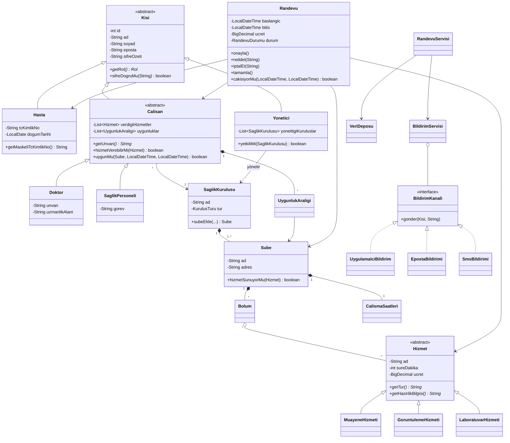
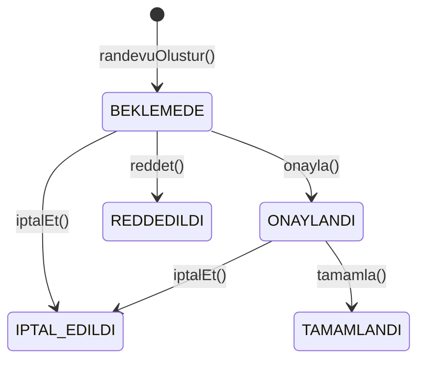

# Hastane / Klinik Randevu Sistemi

Nesneye Dayalı Programlama (NDP) dersi dönem projesi, **Seçenek A**.

Tek şubeli klinikleri ve çok şubeli hastaneleri destekleyen, rol tabanlı bir randevu sistemi.
Java 21 ile yazılmış bir konsol uygulamasıdır ve harici kütüphane kullanmaz.

| | |
|---|---|
| **Öğrenci** | _Berkant ÖNTEMEL_ |
| **Numara** | _Y255012117_ |
| **Dil / Sürüm** | Java 21 |

---

## Özellikler ve proje gereksinimlerinin karşılanması

| Gereksinim | Karşılandığı yer |
|---|---|
| Hastane/klinikler yetki çerçevesinde tanımlanır | `YonetimServisi` (her işlemde `yetkiKontrol`), `Yonetici.yetkiliMi()` |
| Tek klinik **ve** çok şubeli kuruluş desteği | `SaglikKurulusu` → 1..* `Sube` (tek şubeli klinikte de bir "Merkez" şube vardır) |
| Çalışma saatleri ve bölümler | `CalismaSaatleri` (gün gün açılış-kapanış), `Bolum` |
| Hizmetler: süre ve ücret | `Hizmet` (soyut) → `MuayeneHizmeti`, `GoruntulemeHizmeti`, `LaboratuvarHizmeti` |
| Doktor ve sağlık personeli kaydı | `Calisan` (soyut) → `Doktor`, `SaglikPersoneli` |
| Doktorun uzmanlık alanı ve verdiği hizmetler | `Doktor.uzmanlikAlani`, `Calisan.verdigiHizmetler` |
| Uygunluk zaman dilimleri, randevu sadece bu aralıklarda alınır | `UygunlukAraligi`, `Calisan.uygunMu()`, `RandevuServisi.bosSaatler()` |
| Çalışan ve işlem seçerek randevu oluşturma | `HastaMenusu.randevuAl()`: kurum → şube → hizmet → çalışan → gün → saat |
| **Çakışma kontrolü** | `RandevuServisi.engelBul()`: çalışan **ve** hasta için çakışma kontrol edilir |
| Randevu detayları (işlem, süre, ücret, çalışan, tarih/saat) | `Randevu` (süre ve ücret randevu anında kopyalanır) |
| **Onay mekanizması** | `Randevu.onayla() / reddet()`, durum makinesi (`RandevuDurumu`) |
| En az 3 rol | Hasta, Doktor / Sağlık Personeli, Hastane-Klinik Yöneticisi |
| Ek | Uygulama içi + e-posta + SMS bildirimleri (simülasyon), şifre özeti (SHA-256), 20 birim testi |

---

## Çalıştırma

Bilgisayarınızda **JDK 17 veya üstü** kurulu olmalıdır (`javac -version` ile kontrol edebilirsiniz).

| | Windows | Mac / Linux |
|---|---|---|
| Uygulamayı çalıştır | `run.bat` dosyasına çift tıklayın | `./run.sh` |
| Testleri çalıştır | `test.bat` | `./test.sh` |

IntelliJ IDEA ile: klasörü açın, `src/hastane/Main.java` dosyasındaki ▶ düğmesine basın.

### Demo hesaplar (hepsinin şifresi `1234`)

| Rol | E-posta |
|---|---|
| Yönetici (Yıldız Hastanesi, 2 şube) | `mehmet.kaya@yildiz.test` |
| Yönetici (Papatya Göz Kliniği, tek şube) | `selin.koc@papatya.test` |
| Doktor | `ayse.yilmaz@yildiz.test`, `can.demir@yildiz.test`, `zeynep.arslan@papatya.test` |
| Sağlık personeli | `elif.sahin@yildiz.test` (radyoloji), `burak.oz@yildiz.test` (laborant) |
| Hasta | `ahmet.celik@hasta.test`, `fatma.aydin@hasta.test` |

> Kurum ve kişi adları tamamen hayalidir, ücretler örnek değerlerdir. Veriler bellekte tutulur; program kapanınca sıfırlanır.

---

## Proje yapısı (katmanlar)

```
src/hastane/
├── Main.java               Başlangıç noktası
├── DemoVeri.java           Örnek kurum, çalışan, hasta ve randevular
├── model/                  Alan sınıfları (iş nesneleri)
│   ├── Kisi (soyut) ─┬─ Hasta
│   │                 ├─ Calisan (soyut) ─┬─ Doktor
│   │                 │                   └─ SaglikPersoneli
│   │                 └─ Yonetici
│   ├── Hizmet (soyut) ─┬─ MuayeneHizmeti
│   │                   ├─ GoruntulemeHizmeti
│   │                   └─ LaboratuvarHizmeti
│   ├── SaglikKurulusu, Sube, Bolum, CalismaSaatleri, SaatAraligi, UygunlukAraligi
│   ├── Randevu, RandevuDurumu (enum), Rol (enum), KurulusTuru (enum)
│   └── Dogrulama, Bicim     Yardımcı sınıflar
├── istisna/                Özel hata sınıfları (HastaneException ve alt sınıfları)
├── depo/                   VeriDeposu: bellekteki veri
├── bildirim/               BildirimKanali (interface) ve kanallar
├── servis/                 İş kuralları: RandevuServisi, YonetimServisi, KimlikServisi, HastaneSistemi
├── arayuz/                 Konsol menüleri (Menu soyut sınıfı + rol menüleri)
└── test/                   SistemTestleri
```

Bağımlılık yönü: `arayuz → servis → model`. Model katmanı arayüzden habersizdir. Aynı servisler ileride bir web ya da masaüstü arayüzüyle de kullanılabilir.

---

## UML sınıf diyagramı



### Randevu durum diyagramı



`BEKLEMEDE` ve `ONAYLANDI` durumları **aktif** sayılır, yani zaman dilimini meşgul eder. Reddedilen ya da iptal edilen randevunun saati yeniden alınabilir.

---

## NDP ilkelerinin uygulanışı

| İlke | Nerede / nasıl |
|---|---|
| **Kapsülleme** | Tüm alanlar `private`. Değişiklikler doğrulama yapan metotlarla yapılır (ör. `Hizmet.setUcret` negatif değeri reddeder). `Randevu.durum` için setter yoktur, durum sadece `onayla()`, `reddet()` gibi kurallı metotlarla değişir. Şifre hiç dışarı verilmez, sadece SHA-256 özeti tutulur. Listeler `Collections.unmodifiableList` ile salt-okunur döndürülür. |
| **Kalıtım** | `Kisi → Hasta / Calisan / Yonetici`, `Calisan → Doktor / SaglikPersoneli`, `Hizmet → 3 alt tür`, `HastaneException → 3 alt hata`, `Menu → 3 rol menüsü` |
| **Çok biçimlilik** | `getRol()`, `getUnvan()`, `getTur()`, `getHazirlikBilgisi()` alt sınıflarda farklı çalışır. `BildirimServisi` hangi kanala gönderdiğini bilmeden `kanal.gonder()` çağırır. `GirisEkrani` kullanıcı türüne göre farklı `Menu` nesnesi üretir ama hepsine aynı `calistir()` çağrısını yapar. |
| **Soyutlama** | Soyut sınıflar: `Kisi`, `Calisan`, `Hizmet`, `Menu`. Arayüz: `BildirimKanali`. |
| **Generic yapılar** | `VeriDeposu.kisileriGetir(Class<T>)`, `Konsol.listedenSec(List<T>)` |
| **Özel istisnalar** | `RandevuCakismaException`, `GecersizIslemException`, `YetkiException` |

### Kullanılan tasarım desenleri

- **Facade:** `HastaneSistemi`, depo ve servisleri tek noktada toplar.
- **Strategy:** `BildirimKanali` arayüzü. Yeni bir kanal eklemek için mevcut kodu değiştirmeye gerek yoktur (SOLID'deki Açık/Kapalı prensibi).
- **Template Method:** `Menu.calistir()` menü döngüsünü bir kez tanımlar, alt sınıflar sadece seçenekleri verir.
- **Factory Method:** `GirisEkrani.menuOlustur()` rolüne göre menü üretir, `CalismaSaatleri.haftaIci()` hazır takvim üretir.

---

## Çakışma kontrolü nasıl çalışır?

İki zaman aralığı `[a1, a2)` ve `[b1, b2)` **ancak ve ancak** `a1 < b2` **ve** `b1 < a2` ise çakışır.
Bu yüzden 09:00-09:20 ile 09:20-09:40 çakışmaz, 09:00-09:20 ile 09:10-09:30 çakışır.

`RandevuServisi` yeni bir randevu için sırasıyla şunları kontrol eder:

1. Zaman geçmişte mi?
2. Şube bu hizmeti veriyor mu?
3. Çalışan bu hizmeti veriyor mu?
4. Şube o saatte açık mı?
5. Çalışan o saatte o şubede müsait mi (uygunluk aralığı)?
6. Çalışanın **veya hastanın** o saatte başka bir aktif randevusu var mı?

Boş saat listesi de aynı kontrolden geçtiği için hastaya sadece gerçekten alınabilir saatler gösterilir.

---

## Testler

`SistemTestleri` sınıfında harici kütüphane gerektirmeyen 20 test vardır: çakışma, bitişik randevu, uygunluk dışı saat, kapalı gün, onay mekanizması, yetki, boş saat hesabı, çok biçimlilik vb.

```
[ OK ] Aynı doktora aynı saatte ikinci randevu -> çakışma
[ OK ] Bitişik randevular çakışmaz (09:00-09:20 ve 09:20-09:40)
[ OK ] Başka kuruluşun yöneticisi şube ekleyemez (yetki)
...
SONUÇ: 20 başarılı, 0 başarısız
```

---

## Geliştirme önerileri

- Verilerin bir veritabanında (ör. SQLite / PostgreSQL) kalıcı olarak saklanması (`VeriDeposu` yerine bir veritabanı katmanı yazılabilir)
- Web arayüzü (Spring Boot) veya masaüstü arayüzü (JavaFX). Servis katmanı değişmeden kullanılabilir.
- Gerçek e-posta/SMS entegrasyonu (yeni bir `BildirimKanali` sınıfı yazmak yeterli)
- Randevu hatırlatma (randevudan 1 gün önce bildirim), bekleme listesi
- Sigorta/SGK türüne göre ücret hesaplama (Strategy deseniyle)
